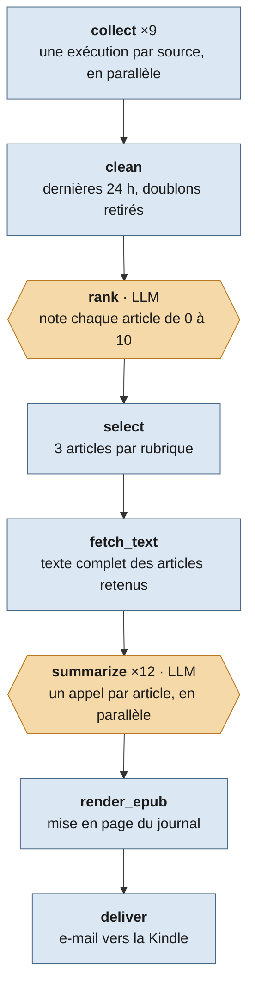

# Kindle Digest

Un journal du matin, fabriqué chaque jour par un pipeline et envoyé sur ma liseuse.

**En ligne** : [le pipeline étape par étape, avec les mesures de chaque run](https://titou404.github.io/kindle-digest/) · [le banc d'évaluation qui a fixé la config](https://titou404.github.io/kindle-digest/config.html)

## Pourquoi ce projet

Le matin, j'aime lire. Mais lire l'actualité sur son téléphone, c'est se faire happer tout de suite : des notifications, un fil sans fin, et un écran plein de lumière bleue dès le réveil. Je voulais lire l'actualité sans être exposé à trop d'actualité : un nombre fini d'articles, choisis pour moi, sur un écran reposant.

D'où l'idée d'un journal numérique qui arrive tout seul sur ma Kindle, dont l'écran à encre électronique n'affiche ni notification ni fil d'actualité.

## Ce que fait le projet

Chaque soir, sans intervention de ma part, pour le journal du lendemain matin :

1. le pipeline collecte environ 250 articles auprès de 9 sources (Hacker News, Reddit, BBC, The Guardian, franceinfo, The Conversation) ;
2. il écarte les articles de plus de 24 h et les doublons : il en reste une centaine ;
3. il garde les 12 qui m'intéressent le plus, 3 par rubrique (Data & IA, Monde, Économie, France) ;
4. il les résume en français, avec une phrase « pourquoi c'est important » ;
5. il assemble un livre EPUB et l'envoie par e-mail sur la Kindle.

Un journal coûte environ 1 centime de dollar et se fabrique en une minute (0,95 à 1,22 centime et 34 à 76 secondes sur les 7 premiers runs réels, cf. [`runs/`](runs/)).

## L'idée défendue : scripter tout ce qui peut l'être

Ce projet m'a servi à défendre une idée : **on n'a pas besoin d'un agent autonome partout**.

Un agent, c'est un LLM qui décide lui-même, en boucle, de la prochaine action à faire avec les outils qu'on lui donne. On pourrait lui dire « prépare-moi un journal » et le laisser chercher, lire et écrire. Mais je ne maîtriserais alors ni son chemin, ni son coût, ni sa durée, et je ne pourrais pas tester grand-chose.

J'ai fait l'inverse : scripter tout ce qui peut l'être, et ne laisser au LLM que la petite part de jugement. La règle tient en deux lignes :

- une tâche qui a une réponse exacte et vérifiable (collecter, filtrer par date, dédoublonner, appliquer des quotas, mettre en page, envoyer) → **un script Python** ;
- une tâche de jugement ou de langue (cet article m'intéresse-t-il ? que dit-il en cent mots ?) → **un appel LLM**.

Résultat : sur les 8 étapes du pipeline, 2 seulement appellent un LLM, pour 13 appels au plus par journal (1 pour le tri, 1 par article résumé). C'est un *workflow* : l'ordre des étapes est fixé par le code. Le LLM ne choisit jamais la suite, n'a aucun outil, et ne fait que répondre à une question précise dans un format imposé.

Ce que ce choix apporte, concrètement :

- **un coût prévisible** : le nombre d'appels est borné par le code, pas par le modèle ;
- **un comportement testable** : 75 tests tournent hors réseau en moins de 2 secondes, avec un faux LLM, donc sans rien payer ;
- **des pannes contenues** : une source qui tombe ou un appel LLM qui échoue ne fait pas tomber le journal, chaque étape a son repli ;
- **des erreurs qu'on peut expliquer** : quand un article est mal choisi ou mal résumé, on sait quelle étape regarder.

La deuxième idée du projet en découle : puisque le LLM n'intervient qu'à deux endroits, on peut **mesurer** précisément ce qu'il coûte et ce qu'il vaut. Chaque appel est enregistré (tokens, durée, coût), et le choix du modèle et de ses réglages s'appuie sur un banc d'évaluation, pas sur une intuition.

## Comment ça marche

Le pipeline est un graphe [LangGraph](https://langchain-ai.github.io/langgraph/) ([`src/digest/graph.py`](src/digest/graph.py)), avec un fichier par étape dans [`src/digest/nodes/`](src/digest/nodes/). En bleu les scripts, en orange les deux étapes confiées au LLM.



| Étape | Ce qu'elle fait | Script ou LLM | Pourquoi |
|---|---|---|---|
| `collect` | Interroge les 9 sources (API et flux RSS) | Script | Une requête a une réponse exacte |
| `clean` | Garde les dernières 24 h, retire les doublons, raccourcit les chapôs | Script | Mêmes entrées, mêmes sorties |
| `rank` | Note chaque article de 0 à 10 d'après mon profil de lecteur | **LLM**, 1 appel | « Est-ce intéressant pour moi ? » est un jugement |
| `select` | Garde les 3 mieux notés de chaque rubrique | Script | Trier des nombres ne demande pas de modèle |
| `fetch_text` | Télécharge le texte des seuls articles retenus | Script | 12 téléchargements au lieu de 100 |
| `summarize` | Résume chaque article en français | **LLM**, 1 appel par article | Résumer et traduire sont des tâches de langue |
| `render_epub` | Assemble le journal et sa page « Bilan du jour » | Script | De la mise en forme |
| `deliver` | Envoie l'EPUB par e-mail à la Kindle | Script | Un envoi réussit ou échoue |

Deux choix dans ce graphe :

- **Le tri juge sur le titre et le chapô, pas sur le texte complet.** Le texte n'est téléchargé qu'après, pour les 12 articles retenus : on ne lit en entier que ce qu'on résume.
- **Les étapes répétées tournent en parallèle** : une exécution de `collect` par source, une de `summarize` par article. Une source en panne ou un résumé raté ne touche que lui-même, et l'erreur est enregistrée dans le rapport du run.

## Choix techniques

**Un seul fichier appelle le modèle.** Tous les appels passent par [`src/digest/llm.py`](src/digest/llm.py), ce qui garantit que chacun est mesuré de la même façon. Ce fichier contient aussi un faux LLM, qui a la même interface et renvoie des réponses fabriquées : avec `--fake`, tout le pipeline tourne sans rien payer. C'est le mode par défaut en développement.

**Le modèle répond dans un format imposé.** Chaque appel fournit un schéma JSON (*structured outputs*) : le tri renvoie une note et un sujet par article, le résumé renvoie deux champs. Le code n'a donc pas à deviner où est la réponse dans un texte libre. Une note absente ou hors de 0–10 vaut 0, et elle est comptée dans le rapport.

**Le texte des articles est une donnée, jamais une instruction.** Il vient d'Internet, donc n'importe qui peut y écrire « ignore tes consignes ». Trois protections : le texte est placé entre des balises `<article>`, ses caractères `<` et `>` sont échappés pour qu'il ne puisse pas fermer la balise, et le prompt dit de ne suivre aucune demande venant de l'article. Et comme le modèle n'a aucun outil, le pire qu'une injection puisse faire est de gâcher un résumé.

**Le réglage de réflexion est fixé pour chaque tâche.** Haiku 5.5 décide à chaque appel s'il réfléchit avant de répondre (*thinking* adaptatif), et cette réflexion est facturée comme du texte produit. Le paramètre `effort` règle sa propension à réfléchir. Je le fixe explicitement : `low` pour le tri, `medium` pour les résumés. Ces deux valeurs viennent du banc d'évaluation décrit plus bas.

**Un appel groupé pour le tri, un appel par article pour les résumés.** Pour le tri, les consignes et mon profil sont envoyés une seule fois pour la centaine de candidats. Pour les résumés, chaque article a son appel : ils tournent en parallèle, et un échec ne fait perdre qu'un résumé.

**Les prompts sont versionnés.** Ils vivent dans [`prompts/`](prompts/) et on n'écrase jamais une version : on en crée une nouvelle (`summarize_v1.md`, `summarize_v2.md`). Chaque appel enregistre la version utilisée, ce qui permet de comparer deux versions sur les mêmes articles.

**Aucune panne ne fait tomber le journal.** Chaque étape a un repli, du plus au moins grave :

| Ce qui casse | Ce que fait le pipeline |
|---|---|
| Une source ne répond pas, ou renvoie un flux vide | Les autres sources continuent, l'erreur est notée |
| Le tri échoue | Le journal prend les articles les plus récents de chaque rubrique |
| Le texte d'un article est illisible | Pas d'appel LLM : le journal affiche le chapô de la source, en le disant |
| Un résumé échoue | Même repli pour cet article, les autres ne sont pas touchés |
| L'envoi par e-mail échoue | Le run sort en erreur, GitHub le signale |

Seul le dernier cas rend le run rouge : un journal qui n'arrive pas est une vraie panne, une source absente ne l'est pas.

**Les sources sont des API et des flux RSS.** Pas d'extraction de pages de liste, pas de contournement de paywall. Les sources payantes ou protégées contre les robots ont été écartées : un article retenu doit pouvoir être lu et résumé. Chaque choix est expliqué dans [`config/sources.toml`](config/sources.toml).

## La mesure en production

Le journal est fabriqué par GitHub Actions ([`.github/workflows/daily.yml`](.github/workflows/daily.yml)), qui lance le pipeline chaque soir vers 20 h : le journal porte la date du lendemain matin, celui où je le lis. Chaque run laisse trois traces.

**Un rapport JSON par run**, dans [`runs/`](runs/), que le workflow commite lui-même. Il contient :

- la config utilisée (modèle, effort et version de prompt de chaque tâche), qui a déclenché le run, et le matin auquel le journal est destiné ;
- l'entonnoir : articles collectés, gardés après nettoyage, retenus, résumés ;
- pour chaque étape, sa durée et ses compteurs ;
- pour chaque appel LLM : tokens d'entrée et de sortie, tokens de réflexion, durée, coût en dollars, raison de fin ;
- les erreurs, source par source ;
- chaque candidat, avec sa note et s'il a été retenu ou non. C'est ce qui permet de répondre à « pourquoi cet article et pas celui-là ? ».

Le coût est calculé à partir des tokens et de la table de prix de [`src/digest/pricing.py`](src/digest/pricing.py).

**Un index**, [`runs/index.json`](runs/index.json), réécrit à chaque run. Une page web statique ne sait pas lister un dossier : elle lit cet index, puis les rapports qu'il nomme. C'est ce qui alimente la [page de suivi](https://titou404.github.io/kindle-digest/).

**Une page « Bilan du jour »** à la fin du journal lui-même : compteurs, coût et incidents du run, lisibles sur la Kindle.

### Les premiers runs

| Run | Déclenché par | Collectés → nettoyés → résumés | Coût | Durée | Incidents |
|---|---|---|---|---|---|
| 14/11, 18 h 08 | mon ordinateur | 259 → 118 → 12 | 1,17 ct | 41 s | envoi refusé |
| 14/11, 19 h 34 | moi, sur GitHub | 256 → 116 → 12 | 1,18 ct | 42 s | aucun |
| 14/11, 19 h 56 | moi, sur GitHub | 244 → 100 → 12 | 0,95 ct | 34 s | Reddit |
| 14/11, 22 h 15 | moi, sur GitHub | 244 → 99 → 11 | 1,14 ct | 68 s | Reddit, 1 article illisible |
| 15/11, 12 h 20 | moi, sur GitHub | 243 → 89 → 11 | 1,16 ct | 68 s | Reddit, 1 article illisible |
| 15/11, 13 h 11 | la planification | 243 → 90 → 11 | 1,22 ct | 76 s | Reddit, 1 article illisible |
| 16/11, 14 h 04 | la planification | 258 → 124 → 11 | 1,00 ct | 59 s | aucune erreur, 1 article sans texte |

Coûts en centimes de dollar. À partir du run de 22 h 15, la durée comprend 30 secondes d'attente volontaire entre les deux requêtes vers Reddit, qui limite les clients anonymes.

Les six premiers runs ont tourné avec la première config (effort `medium` partout, prompt de résumé v1). Celui du 16/11 est le premier avec la config choisie par le banc : le tri n'y réfléchit plus, et prend 14 secondes pour 0,37 centime, contre 28 secondes et 0,49 centime la veille, alors qu'il avait plus d'articles à noter (124 contre 90).

### Ce que ces mesures ont montré

- **Le tri coûte plus cher qu'il n'en a l'air.** Dans le run planifié du 15/11, un seul appel sur douze représente 40 % du coût, et près de la moitié de ce montant paie des tokens de réflexion. Les onze résumés, eux, n'ont pas réfléchi du tout. D'où la question posée au banc : cette réflexion améliore-t-elle le tri ?
- **Reddit ne répond presque jamais.** Flux vide ou erreur 429 à chaque run du 14/11 au soir au 15/11 : la rubrique était vide, mais le journal partait quand même. Le 16/11, pour la première fois, les deux flux ont répondu et le journal contient deux posts.
- **Un défaut que les tests n'avaient pas vu.** Le 15/11, le premier article du journal n'affichait que son titre. Le rapport a permis de remonter la chaîne : un lien Hacker News sans chapô, une page qui boucle sur ses redirections, donc pas de texte, donc pas de résumé, donc un chapô de repli… vide. Chaque repli était testé seul ; seule la combinaison réelle a révélé le problème. Le journal dit maintenant clairement que seul le titre est disponible.
- **La planification de GitHub n'est pas ponctuelle.** Les deux premiers runs planifiés sont partis avec 7 h 40, puis 8 h 33 de retard. Et un run qui n'a pas lieu ne déclenche aucune alerte : GitHub ne prévient que d'un échec.

## Le banc d'évaluation : choisir la config sur des chiffres

Quel modèle, quel effort, quel prompt, quelle longueur de texte ? Plutôt que de choisir à l'intuition, j'ai monté une expérience contrôlée : **les mêmes articles pour tout le monde, un seul réglage qui change à la fois**.

### La méthode

- **Une journée figée.** Le 15/11, j'ai enregistré les 89 candidats du jour (l'entrée du tri) et 12 articles avec leur texte complet (l'entrée des résumés). Toutes les configs travaillent sur ces mêmes données.
- **Une référence, puis un réglage changé par config.** 12 configs : 7 pour les résumés (S1 à S7), 5 pour le tri (R1 à R5). Tester toutes les combinaisons aurait coûté bien plus cher pour répondre à des questions que personne ne pose.
- **Des répétitions.** Le modèle ne répond pas deux fois pareil. Répéter une config mesure ce bruit : une différence entre deux configs plus petite que la différence entre deux runs identiques ne veut rien dire.
- **Le code de production.** Le banc appelle les mêmes fonctions que le pipeline : ce qu'il mesure est ce que ferait le journal.
- **Pas de double paiement.** Faux LLM par défaut, et un résultat réel déjà enregistré n'est jamais relancé.

Le banc complet a coûté 2,96 $, dont 2,20 $ pour le juge. Deux réglages ont été écartés sans payer : Opus 5.5 (40 fois le prix de Haiku, jamais choisi pour un journal à 1 centime) et le cache de prompt (le prompt des résumés est sous le minimum de 512 tokens, et le tri ne tourne qu'une fois par jour alors que le cache vit 5 minutes).

### Comment la qualité est mesurée

- **Résumés** : un script vérifie que chaque nombre et chaque citation figurent dans l'article, puis un juge LLM (Sonnet 5.5, à l'aveugle) vérifie chaque affirmation du résumé, preuve à l'appui.
- **Tri** : j'ai étiqueté moi-même les 89 candidats, « à garder » ou « à jeter ». La mesure est l'**AUC** : la probabilité qu'un article que j'aurais gardé soit mieux noté qu'un article que j'aurais jeté (50 % = le hasard).

### Les résumés

Coût des 12 résumés, et verdicts du juge sur une répétition de chaque config.

| Config | Ce qui change | Coût | Longueur moyenne | Affirmations non soutenues | Points essentiels oubliés |
|---|---|---|---|---|---|
| S1 | Référence : Haiku 5.5, `medium`, prompt v1 | 0,87 ct | 184 mots | 6 sur 143 | 0 |
| S2 | Effort `low` | 0,87 ct | 184 mots | 7 sur 143 | 0 |
| S3 | Effort `high` | 0,93 ct | 181 mots | 7 sur 145 | 0 |
| S4 | Texte coupé à 6 000 caractères | 0,66 ct | 182 mots | 11 sur 147 | 5 |
| S5 | Sonnet 5.5, `medium` | 15,44 ct | 122 mots | 0 sur 115 | 0 |
| S6 | Sonnet 5.5, `high` | 15,51 ct | 123 mots | 2 sur 130 | 0 |
| **S7** | **Prompt v2** | **0,93 ct** | **189 mots** | **2 sur 140** | **0** |

- **`low` et `medium` donnent la même chose** : à `medium`, le modèle ne réfléchit déjà pas avant de résumer. `high` le fait réfléchir un peu (une centaine de tokens par résumé), pour 7 % de plus et aucun gain visible.
- **Couper le texte fait perdre l'essentiel.** S4 coûte 24 % de moins, mais c'est la seule config qui oublie des points essentiels, dont l'idée centrale d'un article, annoncée dans son titre mais développée après les 6 000 premiers caractères.
- **Sonnet résume plus court et un peu plus fidèlement, pour 18 fois le prix.** Il respecte la longueur demandée (122 mots, contre 184 pour Haiku).
- **Le prompt v2 comble l'essentiel de l'écart** : 2 affirmations non soutenues, contre 6 à 7 avec la v1. Une partie de la différence vient de commentaires inutiles sur la source (« l'article est publié par… »), 2 à 4 par config en v1 et aucun en v2 ; le reste, d'erreurs de fond, qui passent de 3 ou 4 à 2.
- **Le prompt v2 arrête le remplissage.** Sur un article de 191 mots, la v1 produisait un « résumé » de 140 à 154 mots ; la v2, de 56 à 75.
- **Aucune config n'invente de chiffres** : sur 1 588 nombres et 48 citations vérifiables, le script n'en trouve aucun qui soit absent de l'article. Ce contrôle ne départage donc pas les configs : c'est le juge qui voit les erreurs sans chiffre, comme une phrase attribuée à la mauvaise personne.

La v2 ne dit pas « sois plus prudent ». Elle prévient le modèle que ses connaissances peuvent être périmées et que le texte est sa seule source, lui demande de garder qui dit quoi et avec quel degré de certitude, et lui interdit de remplir pour atteindre une longueur ([`prompts/summarize_v2.md`](prompts/summarize_v2.md)).

### Le tri

Moyenne des répétitions de chaque config, face à mes 89 étiquettes.

| Config | Ce qui change | Coût | Durée | AUC |
|---|---|---|---|---|
| R1 | Référence : Haiku 5.5, `medium`, un appel groupé | 0,43 ct | 10 à 68 s | 64 % |
| **R2** | **Effort `low`** | **0,27 ct** | **10 s** | **64 %** |
| R3 | Effort `high` | 0,61 ct | 32 à 41 s | 64 % |
| R4 | Sonnet 5.5, `medium` | 5,49 ct | 17 s | 63 % |
| R5 | Un appel par article | 1,92 ct | 15 s | 59 % |

- **Toutes les configs se valent.** Avec 89 étiquettes, la marge d'erreur de l'AUC est d'environ 12 points : aucun écart du tableau n'est significatif. Sonnet, 13 fois plus cher, ne trie pas mieux. Réfléchir plus non plus.
- **`low` est donc le bon choix** : même qualité, 37 % moins cher, et une durée stable. À `medium`, le modèle ne réfléchit pas à chaque fois (deux runs sur trois dans le banc), d'où des durées de 10 à 68 secondes.
- **Le tri est bruité.** Entre deux runs identiques de Haiku, 6 à 11 des 12 articles retenus sont les mêmes ; pour Sonnet, 11. La liste change donc d'un run à l'autre, sans que la qualité mesurée change.
- **Le vrai levier est le profil, pas le modèle.** Toutes les configs font à peine mieux que le hasard. Mon interprétation : elles appliquent toutes le même [`config/profile.md`](config/profile.md), qui décrit mal mes goûts. Deux indices : l'AUC varie beaucoup selon la rubrique (79 % en Monde, 34 % en France), et les désaccords se ressemblent. Je garde des curiosités que le modèle note bas (des jeux NES récents, le lance-grenades des missions Apollo) et je jette de l'actualité « importante » qu'il note haut (la dette publique, le point d'indice des fonctionnaires).

### La config retenue

| Réglage | Choix | Pourquoi |
|---|---|---|
| Modèle | Haiku 5.5 pour les deux tâches | Sonnet ne trie pas mieux, et le prompt v2 rapproche les résumés de Haiku des siens pour un dix-septième du prix |
| Effort du tri | `low` | Même qualité que `medium` et `high`, 37 % moins cher, durée stable |
| Effort des résumés | `medium` | Identique à `low` (aucune réflexion) ; `high` coûte plus sans rien apporter |
| Prompt des résumés | v2 | Moins d'affirmations non soutenues, plus de remplissage |
| Texte des articles | Complet, 20 000 caractères au plus | Le couper à 6 000 fait oublier l'essentiel |

Coût estimé d'un journal avec cette config : 1,2 centime. Le premier run réel, le 16/11, a coûté 1,00 centime.

### Les limites de ce banc

- **Une seule journée** : 12 résumés par config et 89 étiquettes. Seules les grosses différences comptent.
- **Le juge n'est pas encore calibré.** C'est un LLM, qui peut se tromper dans les deux sens. Tant que je n'ai pas comparé ses verdicts aux miens sur un échantillon, les chiffres de fidélité sont une première lecture. Sa première version s'est d'ailleurs contredite : elle a marqué « non soutenue » une affirmation que sa propre preuve disait soutenue. La v2 lui fait écrire la preuve avant le verdict.
- **Le juge et les modèles jugés sont de la même famille**, ce qui n'exclut pas un biais commun. Mes étiquettes sont la seule référence extérieure, et elles ne portent que sur le tri.
- **La v2 change plusieurs règles à la fois** : on sait qu'elle fait mieux, pas quelle règle aide.
- **Un nouveau profil devra être mesuré sur un autre jour.** Le régler sur ces 89 étiquettes puis le mesurer sur les mêmes reviendrait à s'évaluer sur ses propres réponses.

Les résultats bruts sont dans [`eval/results/2026-11-15/`](eval/results/2026-11-15/). Les articles figés ne sont pas versionnés : ils contiennent le texte d'articles de presse.

## Lancer le projet

Il faut Python 3.12 et [uv](https://docs.astral.sh/uv/), qui installe les dépendances dans un environnement propre au projet.

```bash
git clone https://github.com/Titou404/kindle-digest.git
cd kindle-digest
uv sync
```

**Sans rien payer.** Le mode `--fake` remplace le modèle par un faux LLM. La collecte et les téléchargements restent réels, donc il faut une connexion.

```bash
uv run python -m digest --fake
```

Le journal est écrit dans `out/digest-AAAA-MM-JJ.epub`, avec son rapport à côté.

**Les tests et le lint**, hors réseau :

```bash
uv run pytest
uv run ruff check .
```

**Un vrai run** demande un fichier `.env` à la racine, jamais versionné, avec quatre variables :

| Variable | Rôle |
|---|---|
| `ANTHROPIC_API_KEY` | Clé de l'API Anthropic |
| `SMTP_USER` | Adresse Gmail qui envoie le journal |
| `SMTP_APP_PASSWORD` | Mot de passe d'application de ce compte |
| `KINDLE_EMAIL` | Adresse « Envoyer vers Kindle » de la liseuse |

```bash
SEND=1 uv run --env-file .env python -m digest
```

Sans `SEND=1`, le journal est fabriqué mais aucun e-mail ne part. L'adresse d'envoi doit figurer dans les expéditeurs approuvés du compte Amazon.

**Sur GitHub Actions**, les quatre variables sont des secrets du dépôt, et le workflow se lance aussi à la main :

```bash
gh workflow run daily.yml -f send=false
```

**Le banc d'évaluation** tourne lui aussi avec le faux LLM par défaut. Il lui faut d'abord une journée figée, créée à partir du rapport d'un vrai run du jour même :

```bash
uv run python eval/freeze_day.py --scores runs/AAAA-MM-JJ_HHMM.json
```

```bash
uv run python eval/run_bench.py --only S1,R1
```

### Où trouver quoi

| Dossier | Contenu |
|---|---|
| `src/digest/` | Le pipeline : `graph.py`, un fichier par étape dans `nodes/`, `llm.py`, `pricing.py`, `report.py` |
| `config/` | Les sources (`sources.toml`) et mon profil de lecteur (`profile.md`) |
| `prompts/` | Les prompts, versionnés |
| `runs/` | Un rapport par vrai run, et leur index |
| `eval/` | Le banc d'évaluation et ses résultats |
| `tests/` | Les tests, hors réseau |
| `index.html`, `config.html`, `site/` | Les deux pages web du projet (suivi des runs, banc d'évaluation) et le gabarit de la seconde |
| `.github/workflows/` | La planification quotidienne |

## Limites et suite

Ce qui ne marche pas encore bien, par ordre d'importance :

- **La planification de GitHub n'est pas fiable.** Le run prévu à 5 h 30 est parti à 13 h 10 le 15/11 et à 14 h 03 le 16/11. Depuis le 16/11, le journal est donc fabriqué la veille vers 20 h : un retard de plusieurs heures ne se voit plus au réveil. Le retard n'est pas supprimé, seulement rendu sans conséquence. Suite : une alerte quand le rapport du jour manque.
- **La rubrique Reddit est presque toujours vide.** Reddit bride les clients anonymes, depuis GitHub comme depuis mon ordinateur : un seul des cinq derniers runs a obtenu des posts. Suite : passer par son API officielle.
- **Le tri ne reflète pas assez mes goûts.** C'est la conclusion du banc : le journal retient une actualité plus sérieuse que ce que je veux lire. Suite : réécrire le profil, et le mesurer sur une nouvelle journée étiquetée.
- **Le juge n'est pas calibré** sur mes propres vérifications, et le banc ne porte que sur une journée.
- **La config retenue n'a qu'un run d'historique.** Les six premiers runs du tableau ont tourné avec l'ancienne.
- **Un article illisible garde sa place.** Il s'affiche avec son seul titre. Suite : le remplacer par le suivant de sa rubrique.
- **Des mesures manquent** : le coût par tâche, les nouvelles tentatives faites par la librairie en cas d'erreur (elles sont comprises dans la durée mais invisibles), et un recoupement du coût calculé avec la facture réelle.
- **L'arrivée sur la Kindle ne se vérifie pas automatiquement** : Amazon n'offre pas d'API pour cela. Le rapport sait que l'e-mail est parti, pas que le journal est arrivé.
